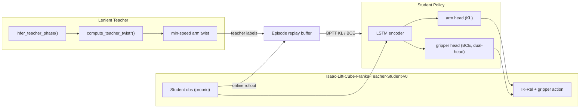

# Vision-Motor Control 实验总结（Franka Lift-Cube）

> 截至 2026-06-18，Isaac Lab 仓库中 Franka 抓方块（lift-cube）相关实验的完整思路、脚本与 checkpoint 对照。

工作目录默认：`/home/l/code/IsaacLab`  
Conda 环境默认：`env_isaaclab`

---

## 0. 当前进展摘要（2026-06-18）

| 路线 | 状态 | 关键结论 |
|------|------|----------|
| **Proprio DAgger** | ✅ **已收敛** | `student_best.pt` @ iter 1400，play **100% lift**（固定 cube+goal） |
| **Vision DAgger** | 🔄 **训练中** | 已至 iter **2000**；eval `success_rate=0%`；play 目测 **grasp 尚可、lift 弱** |
| **Offline CQL 数据集** | ✅ **已采集 v2–v4** | 目录合计 **300 ep / ~404k steps**；success/failure 混合 |
| **Offline CQL 训练** | 🔄 **已跑 ~550 epoch** | sim eval **grasp/lift 仍 0%**（需继续训或调 reward/数据） |

### 0.1 三条并行路线对照

```
Proprio DAgger (10D GT)     Vision DAgger (8ch mask+depth)     Offline CQL (vision + RL)
        │                              │                                  │
   iter 1400 ✅                   iter 2000 🔄                      epoch 550 🔄
   100% lift play                 grasp OK / lift 弱                 sim eval 0%
   cube_pos + goal in obs         无 goal / 无 cube GT in obs        reach-distance reward
```

### 0.2 Vision DAgger 当前瓶颈（待验证）

**现象**（iter ~400–2000 play 目测）：student 能接近 cube 并闭合夹爪，但 **抓取后很少把 cube 抬到 goal**。

**假设**：默认 `OBS_MODE=vision` 的观测 **不含 lift goal**（仅 mask/depth 中的 cube/robot/table/ground 分割）；teacher 在 LIFT 阶段直接读 `command_manager` goal，student 无法从视觉推断抬升方向。

**建议 ablation**（policy-only resume，不加载 15GB+ aggregate buffer）：

```bash
OBS_MODE=vision_proprio \
TASK=Isaac-Lift-Cube-Franka-Vision-Teacher-Student-Proprio-v0 \
RESUME_CHECKPOINT=./runs/lift_cube_dagger_vision/student_iter_400.pt \
./scripts/train_lift_cube_dagger_vision_fresh.sh --no_resume_buffer
```

追加 7D proprio：`ee(3) + gripper(1) + lift_goal(3)`，**仍无 cube GT**。

### 0.3 Offline CQL 数据集（目录合并训练）

路径：`datasets/lift_cube_lenient_teacher_maskdepth/`（训练脚本自动加载全部 `*.hdf5`）

| 文件 | Episodes | Success | Failure | Steps | 备注 |
|------|----------|---------|---------|-------|------|
| `..._v2.hdf5` | 100 | 57 | 43 | ~152k | 首版 balanced mix；有 `*_export_stats.json` |
| `..._v3.hdf5` | 100 | 91 | 9 | ~100k | success 偏高（~91%），CQL 价值排序信号弱 |
| `..._v4.hdf5` | 100 | 58 | 42 | ~153k | 再次 balanced；CQL 当前训练默认单文件指向 v4 |
| **合计** | **300** | **206** | **94** | **~404k** | 合并 success rate ≈ **69%**（偏 success-heavy） |

HDF5 内仍写采集期 `progress_reward`（diagnostic）；**CQL 训练 load 时用 `rewards.py` 重算 reach-distance reward**（`20×Δd_ee_cube + near + success_bonus=1`）。

旧单文件 `lift_cube_lenient_teacher_maskdepth.hdf5`（50 ep，全 success，terminal bonus 主导）**勿再用于 CQL**。

### 0.4 近期工程修复

| 问题 | 修复 |
|------|------|
| 32 env 相机 init `shape invalid for size 0` | `vision_observations.py`：cfg 定 image shape + `_safe_camera_output()` |
| CQL ckpt 用 proprio play → `KeyError: 'model'` | play 脚本族分离 + 友好报错（§6.1） |
| Vision ckpt 用 proprio play 脚本 | 必须用 `play_lift_cube_student_vision_binary_gripper.sh` |
| Resume 训练 `torch.load` CUDA OOM | checkpoint / buffer 均 `map_location="cpu"` |
| `dagger_aggregate.pt` 过大（15–33GB） | resume 优先读磁盘 buffer；`--no_resume_buffer` 仅恢复 policy |
| 采集 shell `tabs` 报错 | `TERM=xterm-256color` |
| 采集 env 提前 timeout 截断 failure | 采集时禁用 `time_out` / `object_dropping`；手动 timeout 导出 failure ep |

### 0.5 Checkpoint 与 Log 速查

| 用途 | 路径 |
|------|------|
| Proprio baseline | `./runs/lift_cube_dagger_binary/student_best.pt` |
| Vision DAgger（进行中） | `./runs/lift_cube_dagger_vision/student_best.pt`（iter 2000，`success_rate=0`） |
| Vision aggregate buffer | `./runs/lift_cube_dagger_vision/dagger_aggregate.pt`（~15GB） |
| CQL 训练 | `./runs/lift_cube_offline_cql_lstm/cql_sac_lstm/`（`checkpoint_epoch_0550.pt` 等） |
| CQL sim eval | `.../sim_eval/metrics_epoch_0550.json`（lift/grasp **0%** @ ep550） |

### 0.6 下一步优先级

1. **Vision `vision_proprio` ablation**：验证 goal 可观测性假设  
2. **Vision DAgger 继续训或调采样**：可选降低 `GRASP_SAMPLE_RATIO`、增加 LIFT phase 采样权重  
3. **CQL**：用目录内 v2+v4（或补采 balanced failure）重训；观察 sim eval 是否脱离 0%  
4. **可选**：视觉 obs 中加入 goal marker；DR（random cube/goal）在 vision 收敛后再做  

---

## 1. 总体目标

在 Isaac Sim 中实现 **Franka 抓方块（lift-cube）** 的 vision-motor 控制，核心路线是：

1. **Oracle / Teacher**：用状态机 + IK-Rel 生成 7D EE twist 标签（6D 速度 + gripper）
2. **Student**：LSTM 策略从 proprio（Phase 2：双相机 mask+depth）模仿 teacher
3. **DAgger 蒸馏**：β 混合 teacher/student 执行 + aggregate buffer 纠正 covariate shift
4. **评估**：仿真 rollout 测 grasp / lift 成功率，可视化脚本检查行为

动作空间：**IK-Rel delta pose + finger position**（与 `twist_to_env_action` 映射一致）。

**当前 proprio baseline（已收敛）**：`./runs/lift_cube_dagger_binary/student_best.pt`（iter 1400，play 验证 **100% lift success**）。

**当前 vision 路线（进行中）**：`./runs/lift_cube_dagger_vision/`（iter 2000+）；详见 §0.2、§3.8。

**当前 offline CQL 路线（进行中）**：数据集 §0.3；训练 `runs/lift_cube_offline_cql_lstm/`；详见 §3.10。

---

## 2. 系统架构



### 2.1 注册环境（Gym ID）

| Gym ID | 用途 |
|--------|------|
| `Isaac-Lift-Cube-Franka-v0` | 标准 joint-pos RL / oracle demo 录制 |
| `Isaac-Lift-Cube-Franka-Play-v0` | 上述 play 配置 |
| `Motrix-Lift-Cube-Franka-v0` | Motrix 奖励 / SKRL PPO 训练 |
| `Motrix-Lift-Cube-Franka-Play-v0` | Motrix play |
| `Isaac-Lift-Cube-Franka-Oracle-Data-v0` | Goal-conditioned HDF5 采集（RGB + twist） |
| `Isaac-Lift-Cube-Franka-Oracle-Offline-v0` | 固定 cube 位姿 + noisy offline 采集 |
| `Isaac-Lift-Cube-Franka-Teacher-Student-v0` | Teacher-student KL 在线训练 |
| `Isaac-Lift-Cube-Franka-Teacher-Student-Play-v0` | Teacher-student play 配置 |
| `Isaac-Lift-Cube-Franka-Oracle-Twist-Play-v0` | Oracle / teacher / student 可视化（带相机） |
| `Isaac-Lift-Cube-Franka-Oracle-Twist-Play-Random-v0` | 随机 cube + goal 的 teacher 可视化 |
| `Isaac-Lift-Cube-Franka-Vision-MaskDepth-Play-v0` | Phase 2：双相机 GT mask（cube=白）+ depth 验证 |
| `Isaac-Lift-Cube-Franka-IK-Rel-v0` | IK-Rel 控制 |
| `Isaac-Lift-Cube-Franka-IK-Abs-v0` | IK-Abs + 内置 SM 演示 |

核心代码目录：

```
source/isaaclab_tasks/.../lift/mdp/
├── oracle/                  # 严格 oracle SM
├── teacher_student/         # teacher 标签、student 网络、KL trainer、eval
│   ├── teacher.py           # twist 计算、min-speed、binary gripper
│   ├── teacher_phase.py     # lenient phase（与 strict SM 解耦）
│   ├── kl_trainer.py        # buffer、grasp 优先采样、KL/BCE 优化
│   ├── dagger_trainer.py    # DAgger β schedule、aggregate buffer
│   ├── vision_observations.py  # GT mask + depth obs（Phase 2）
│   ├── networks.py          # StudentTwistPolicy / StudentTwistPolicyBinaryGripper
│   └── eval.py              # 训练内 eval（success_rate、KL）
└── data_collection.py       # grasp/lift 判定、oracle step 数据
```

---

## 3. 实验思路演进

### 3.1 基线：Oracle → Twist → Teacher-Student KL

- **Oracle**：GPU state machine（reach → grasp → lift），见 `LiftCubeOraclePolicy`
- **Teacher 标签**：`compute_teacher_twist()` 将 desired EE pose 映射为 6D twist + continuous gripper rate
- **Student**：`StudentTwistPolicy`（单头 7D Gaussian），BPTT + KL 模仿 teacher
- **训练脚本**：`train_lift_cube_teacher_student.sh` → `policy_type: continuous`

**现象**：arm 能学到接近 cube 的高度，但 **gripper close / grasp 学不动**；日志中 `sm_end_above` 高、grasp/lift ≈ 0。

### 3.2 Lenient Teacher Phase

**问题**：严格 oracle SM 在 ABOVE 阶段停留过久，teacher 的 grasp 标签稀疏。

**改动**（`teacher_phase.py`）：
- `infer_teacher_phase()` 按 EE–cube 几何（高度、xy 距离）推断 phase
- 不依赖 1 cm waypoint 或 SM timer
- EE 已接近 cube 时，teacher 提前进入 APPROACH / GRASP 标签

连带更新：`teacher.py`、`gripper_schedule.py`、`early_done.py` 均使用 lenient phase。

### 3.3 Plan A：Grasp 优先 Buffer 采样

**问题**：buffer 里 grasp 段比例低，BPTT 采样很少碰到 close 标签。

**改动**（`kl_trainer.py`）：
- `EpisodeData.teacher_phase` 记录每步 phase
- `sample_sequences(..., grasp_sample_ratio=0.7, min_grasp_phase=3)` 优先采 GRASP 及以上 phase 的序列
- 日志：`train/grasp_sample_hit_rate`

### 3.4 Dual-Head Binary Gripper（解耦 arm KL + gripper BCE）

**问题**：7D 联合 KL 下，gripper 维被 arm 主导。

**改动**（`networks.py` + `kl_trainer.py`）：
- `StudentTwistPolicyBinaryGripper`：共享 GRU + 独立 `arm_head` + `gripper_head`
- `optimize_kl_bce_batch`：**两次 backward**
  - arm KL → 更新 encoder + arm head
  - gripper BCE → 仅更新 gripper head（encoder 冻结）
- checkpoint：`policy_type: binary_gripper_dual_head`

**现象**：~10500 iter 能 visually close；之后 arm **回退到 cube 上方 hover**。

### 3.5 Hover 均衡根因、Phase 修正与 Min-Speed Teacher

**根因**：
- Lenient teacher 在 ABOVE 阶段目标 = cube + 10 cm hover
- EE 到达 hover 后 pos_error ≈ 0 → teacher twist **v ≈ 0**
- 仅给零速度补 −Z min-speed 不够：下一步仍会被 ABOVE 的 hover 目标拉回，形成悬停/小振荡
- Student 的 arm KL 下降 = **学会匹配 hover 的零速度 teacher**，不是任务成功
- `eval/success_rate` 在 dual-head run 中全程 ≈ 0%

**改动**（`teacher.py`）：
- `_apply_min_arm_twist_speed()`：当速度低于阈值时注入最小速度
- 默认：`TEACHER_MIN_LIN_SPEED_M_S=0.10`，`TEACHER_MIN_ANG_SPEED_RAD_S=0.20`
- pos_error ≈ 0 时默认沿 **−Z** 注入最小线速度，打破零速度均衡

**补充修正**（`teacher_phase.py`）：
- `ABOVE` 只作为 staging phase：移动到 cube 上方并对齐 xy
- 当 EE 已进入 hover band（默认 `cube + 10cm ± 2cm`）且 xy 已对齐（默认 `<=6cm`）时，立即切到 `APPROACH`
- `APPROACH` 的目标是 cube，本质上强制 teacher 下探，而不是继续追 `cube + 10cm` hover

**注意**：旧 buffer 含 v≈0 标签，启用 min-speed 后需 **重新 collect + 训练**（见 `train_lift_cube_dual_head_fresh.sh`）。

### 3.7 DAgger 蒸馏（**已收敛：100% lift success**）

**动机**：在线 ring buffer（~200 ep、始终 student 执行）covariate shift 大，grasp/lift 收敛慢。

**算法**（`dagger_trainer.py` + `train_lift_cube_dagger_binary_gripper.py`）：
- Rollout：以概率 **β** 执行 teacher twist，否则 student twist
- **标注**：每步仍用 lenient teacher twist 写入 aggregate buffer（经典 DAgger relabel）
- **训练**：从 aggregate buffer 采样 **truncated BPTT**（`grad_interval=20`），arm KL + gripper BCE
- **β schedule**（fresh run 默认）：
  - `BETA_ADAPTIVE=1`：根据 eval success EMA 自适应，达到 `BETA_SUCCESS_TARGET=0.5` 后才接近 `BETA_END=0`
  - 固定 schedule 备选：warmup 100 iter（β=1）→ 线性衰减 2000 iter → β=0
- **Buffer**：FIFO 上限 500 ep；`SUCCESS_RESERVE_RATIO=0.35` 保留 teacher 成功轨迹
- **网络**：GRU → **LSTM**；hidden state `(h, c)` 需在 eval/play reset 时用 `init_hidden()`
- **Resume**：checkpoint + `dagger_aggregate.pt` 同目录持久化

#### 3.7.1 成功版本配置（2026-06-15 fresh run）

| 项 | 值 |
|----|-----|
| **Checkpoint** | `./runs/lift_cube_dagger_binary/student_best.pt` |
| **迭代** | iter **1400**（global_step 89600） |
| **Eval success** | **100%**（50 ep，保存 best 时） |
| **Play 验证** | **100% lift success**（`play_lift_cube_student_binary_gripper.sh`） |
| **训练停止** | ~iter 1435，loss 平台期，可停训 |
| **Task** | `Isaac-Lift-Cube-Franka-Teacher-Student-v0` |
| **Cube 位置** | **固定**默认 spawn（`pose_range` 全 0） |
| **Lift goal** | **固定** `(0.5, 0.0, 0.375)` robot base frame |
| **Episode** | 30 s（1500 steps） |
| **NUM_ENVS** | 256 |
| **Shell** | `./scripts/train_lift_cube_dagger_fresh.sh` |

**Loss 收敛曲线（fresh run）**：

| 阶段 | iter | total_loss | arm_kl | 备注 |
|------|------|------------|--------|------|
| 起步 | 50 | ~648 | ~648 | β=1，纯 teacher rollout |
| 快速下降 | 500 | ~39 | ~39 | buffer 填充中 |
| 平台期 | 800–1400 | **3–6** | **3–6** | eval 100% @ iter 1400 |
| 末段 | 1336–1435 | mean **3.7** ± 0.55 | — | 优化饱和 |

**已知日志陷阱（已修代码，本次 run 的 TB 仍受影响）**：
- 旧 eval 在 timeout 帧用 post-step 状态判 success → TB `eval/success_rate` 大量 0% 噪声
- 已修：`EpisodeLiftSuccessTracker` + success 提前结束 episode（`eval.py` / play 脚本）
- `sampler/lift_success_rate=0` + `rollout: no episodes`：`collect_steps=64` 内 episode 常跑不完，**不代表 policy 失败**

**Play checkpoint**：
```bash
CHECKPOINT=./runs/lift_cube_dagger_binary/student_best.pt \
  ./scripts/play_lift_cube_student_binary_gripper.sh
```

**注意**：目录内 `student_iter_1500.pt`–`4800.pt` 来自**上一轮失败 run**（eval≈2%），勿 resume；仅使用 iter ≤1400 的 fresh checkpoint。

#### 3.7.2 Cube / Lift goal 扰动（已实现 CLI）

Student obs 为 10D proprio：`ee_pos(3) + gripper(1) + cube_pos(3) + lift_goal(3)`。  
**固定场景 checkpoint（`student_best.pt`）不能直接泛化到随机场景**，DR 需 **新 LOG_DIR + 从头训练**。

| 能力 | Train | Play |
|------|-------|------|
| 固定 cube + goal | 默认 | 默认 |
| `--randomize_cube` | ✅ | ✅ |
| `--randomize_lift_goal` | ✅ | ✅ |
| 固定 goal 坐标 | `LIFT_GOAL_X/Y/Z` | 同左 |

实现：`env_randomization.py` → `apply_lift_teacher_student_env_randomization()`  
Cube range：`x∈[-0.1,0.1], y∈[-0.25,0.25]`；Goal range：Isaac 默认 `pos_x∈[0.4,0.6], pos_y∈[-0.25,0.25], pos_z∈[0.25,0.5]`。

```bash
# Domain randomization 训练（shell 自动把 buffer 默认提到 2000 ep）
RANDOMIZE_CUBE=1 RANDOMIZE_LIFT_GOAL=1 LOG_DIR=./runs/lift_cube_dagger_dr \
  ./scripts/train_lift_cube_dagger_fresh.sh

# Play 测 DR（需 DR checkpoint）
RANDOMIZE_CUBE=1 RANDOMIZE_LIFT_GOAL=1 \
  CHECKPOINT=./runs/lift_cube_dagger_dr/student_best.pt \
  ./scripts/play_lift_cube_student_binary_gripper.sh
```

**Buffer / episode 建议（DR 时建议增大）**：

| 参数 | 固定场景 | DR（cube 和/或 goal） |
|------|----------|------------------------|
| `MAX_AGGREGATE_EPISODES` | 500 | **1500–3000**（shell DR 默认 2000） |
| `ORACLE_DEMO_MAX_EPISODES` | 200 | **400+**（若用 HDF5 预加载） |
| `SUCCESS_RESERVE_RATIO` | 0.35 | 保持；success pool 需覆盖更多 (cube,goal) 组合 |
| `MAX_ITERATIONS` | ~1400 收敛 | **3000+**（任务更难） |
| `EVAL_EPISODES` | 50 | **100**（eval 方差更大） |

不必增大 `NUM_ENVS` 或 `COLLECT_STEPS` 的优先级低于 buffer：DR 的核心是 aggregate 里 **覆盖足够多的 teacher 成功轨迹**；500 ep 对单点足够，对组合空间不够。

### 3.8 Phase 2：Vision DAgger（mask + depth，**训练中**）

**目标**：将 student 输入从 10D proprio（含 cube 位置 GT）替换为 **双相机 GT mask + depth**，沿用 offline CQL 同款 8 通道 stack + `VisualCNNEncoder` + LSTM dual-head。

**观测设计**（与 offline CQL `obs_mode=vision` 一致）：
| 通道 | 来源 | 说明 |
|------|------|------|
| `ee_mask` | Replicator `semantic_segmentation` | cube 像素 = **白色 (1,1,1)**；robot/table/ground 每 episode 随机色（≠白） |
| `ee_depth` | `distance_to_image_plane` | 归一化 depth [0,1] |
| `third_person_mask` | 同上 | 第三人称视角 |
| `third_person_depth` | 同上 | 第三人称 depth |

可选 `obs_mode=vision_proprio`：在上述 8 通道外追加 7D proprio（EE pose + goal，**无 cube GT**）。

**训练 env**：`Isaac-Lift-Cube-Franka-Vision-Teacher-Student-v0`（及 `-Proprio-v0`）

**实现文件**：
- `vision_teacher_student_env_cfg.py` — DAgger vision env + Gym 注册
- `vision_networks.py` — `StudentTwistPolicyBinaryGripperVision`（CNN+LSTM dual-head）
- `vision_policy_obs.py` — `stack_visual_from_policy_obs_torch`（64×64 area resize）
- `vision_kl_trainer.py` / `vision_dagger_trainer.py` — vision aggregate buffer + BPTT KL+BCE
- `train_lift_cube_dagger_vision_binary_gripper.py` + `scripts/train_lift_cube_dagger_vision_fresh.sh`
- `play_lift_cube_student_vision_binary_gripper.py` — eval/play

**默认超参**（对齐 proprio DAgger 成功 run，但 env 数更低因显存）：
- `NUM_ENVS=64`，`image_size=64`，`max_aggregate_episodes=500`
- adaptive β、success-reserved buffer 35%、grasp-biased sampling 0.7
- **Gripper 损失**：与 proprio dual-head 相同——arm KL（更新 encoder+arm_head）+ gripper BCE（仅 gripper_head，encoder 冻结）；`gripper_bce_weight=1.0`
- **不支持** proprio HDF5 oracle preload（online aggregate only）

#### 3.8.1 当前训练状态（2026-06-18）

| 项 | 值 |
|----|-----|
| LOG_DIR | `./runs/lift_cube_dagger_vision` |
| 最新 iter checkpoint | `student_iter_2000.pt`（policy ~4MB；部分 iter 含 embedded buffer 可达 24–33GB） |
| `student_best.pt` | iter **2000**，checkpoint 内 `success_rate=0.0`（eval 尚未超过阈值） |
| aggregate buffer | `dagger_aggregate.pt` ~**15GB** |
| Play 目测（iter 400–2000） | **Grasp 行为出现**；**lift-to-goal 弱/缺失** |
| 与 proprio 差距 | proprio 有 cube_pos + lift_goal GT；vision-only **无 goal** |

#### 3.8.2 Goal 可观测性分析

| 信息 | Proprio student | Vision (`obs_mode=vision`) | Vision+proprio |
|------|-----------------|------------------------------|----------------|
| Cube 位置 | ✅ GT 3D | 间接（mask 白像素） | 间接 |
| Lift goal | ✅ GT 3D | ❌ 不在 obs | ✅ GT 3D（7D proprio 后缀） |
| Teacher LIFT 阶段 | 读 command goal | 同左 | 同左 |

Teacher 在 LIFT 阶段目标为固定 command `(0.5, 0, 0.375)`；debug_vis marker **不在** segmentation 白名单内，student 无法从 mask/depth  alone 推断抬升方向。

#### 3.8.3 Resume / Buffer 注意

```bash
# 从头 vision DAgger（固定 cube + goal）
./scripts/train_lift_cube_dagger_vision_fresh.sh

# 仅恢复 policy（跳过 15GB+ buffer，适合换 OBS_MODE 做 ablation）
RESUME_CHECKPOINT=./runs/lift_cube_dagger_vision/student_iter_400.pt \
  ./scripts/train_lift_cube_dagger_vision_fresh.sh --no_resume_buffer

# vision + 7D proprio（无 cube GT）— 推荐下一步
OBS_MODE=vision_proprio \
TASK=Isaac-Lift-Cube-Franka-Vision-Teacher-Student-Proprio-v0 \
RESUME_CHECKPOINT=./runs/lift_cube_dagger_vision/student_iter_400.pt \
  ./scripts/train_lift_cube_dagger_vision_fresh.sh --no_resume_buffer

# Play（必须用 vision play 脚本）
CHECKPOINT=./runs/lift_cube_dagger_vision/student_best.pt \
  ./scripts/play_lift_cube_student_vision_binary_gripper.sh
```

### 3.9 并行路线：数据采集 & 经典 RL

| 路线 | 目的 |
|------|------|
| Goal-conditioned HDF5 | 离线 BC / 分析；含 RGB、goals/phase、twist action |
| Noisy offline demos | 固定 cube + 噪声子策略，模拟 sub-optimal → optimal |
| **Lenient teacher mask+depth HDF5** | **Offline CQL 数据集**（见 §3.10） |
| SKRL PPO (`Motrix-Lift-Cube-Franka-v0`) | 端到端 RL baseline（joint pos，非 teacher-student） |

### 3.10 Offline CQL-SAC LSTM（lenient teacher mask+depth，**已实现**）

**目标**：用 lenient teacher + 动作噪声采集 **success/failure 混合** 离线数据集，dense scaled Δprogress reward 训练 CQL-SAC LSTM，在仿真中 rollout 评估 recovery 能力（非 DAgger 模仿）。

**与 DAgger student 的区别**：

| 项目 | DAgger student | Offline CQL |
|------|----------------|-------------|
| 训练脚本 | `train_lift_cube_dagger_*.sh` | `train_lift_cube_offline_cql_lstm.sh` |
| Play 脚本 | `play_lift_cube_student_*_binary_gripper.sh` | **`play_lift_cube_offline_cql_lstm.sh`** |
| Checkpoint key | `model` | **`agent`** + `action_stats` + `args` |
| 动作输出 | 7D twist → `twist_to_env_action` | **8D env_actions**（IK-Rel + gripper，直接 `step`） |
| 观测 | proprio 或 vision dual-head | vision mask+depth + LSTM history（`obs_mode=vision`） |

**⚠️ 常见错误**：用 `play_lift_cube_student_binary_gripper.sh` 加载 CQL checkpoint 会报 `KeyError: 'model'`。CQL checkpoint 必须用 `play_lift_cube_offline_cql_lstm.sh`。

**数据集目录**（训练时自动合并目录下所有 `*.hdf5`）：

```
datasets/lift_cube_lenient_teacher_maskdepth/   # 合计 ~8.6GB
├── lift_cube_lenient_teacher_maskdepth_v2.hdf5   # 100 ep, 57/43, ~152k steps
├── lift_cube_lenient_teacher_maskdepth_v3.hdf5   # 100 ep, 91/9,  ~100k steps (偏 success)
├── lift_cube_lenient_teacher_maskdepth_v4.hdf5   # 100 ep, 58/42, ~153k steps
└── *_export_stats.json / *_reward_hist.png        # 分析输出
```

默认 `--dataset_file ./datasets/lift_cube_lenient_teacher_maskdepth`（目录或单个 `.hdf5` 均可）。  
当前 CQL run（`config.json`）曾单指向 **v4**；推荐改为 **整个目录** 以合并 v2+v4 balanced 子集（v3 可选排除或补采 failure）。

**Reward 设计**（采集仍写 `rewards/progress_reward` / `progress_delta` 到 HDF5；**CQL 训练在 load 时重算**，不读 progress reward）：

| 项 | 值 | 说明 |
|----|-----|------|
| `reach_reward` | `20 × (d_ee_cube_t − d_ee_cube_{t+1})` | 主信号：靠近 cube 为正 |
| `near_reward` | `0.1 × exp(−30 × d_ee_cube_{t+1})` | 近 cube  shaping（5cm→2cm 比 30cm→27cm 敏感得多） |
| `success_bonus` | **1.0**（成功步）/ **0** | 小 terminal bonus，不用 10/20 |
| `reward_total` | 以上三项之和 | 无 grasp/lift/goal/progress 项 |
| `progress_delta` | HDF5 仅 diagnostic | 不参与 CQL |

实现：`mdp/teacher_student/offline_cql/rewards.py`；`dataset.py` 从 `ee_pose` + `obs/student_state` cube 位置重算。

数据集组成目标为 success + failure 混合（`success_rate ≈ 0.4–0.6`）。v2/v4 已达标；**v3 偏 success（91%）**；合并 300 ep 后整体 ~69% success，后续采集应 **优先 failure / 半成功轨迹**。

#### 3.10.1 CQL 训练状态（2026-06-18）

| 项 | 值 |
|----|-----|
| LOG_DIR | `./runs/lift_cube_offline_cql_lstm/cql_sac_lstm/` |
| 进度 | checkpoint 至 **epoch 550+**（`checkpoint_best.pt` / `checkpoint_eval_latest.pt`） |
| Sim eval（20 ep） | epoch 50–550：**lift_success_rate=0%**，**grasp_success_rate=0%** |
| `mean_final_cube_to_goal` | ~0.354 m（cube 未进 goal 区域） |
| Reward @ load | reach-distance（§上表）；非 HDF5 progress_reward |

Sim eval 长期 0% 可能原因：数据仍偏 imitation-friendly、reward 仅 shaping 靠近 cube（不含 goal 距离）、或需更多 epoch / 调 `cql_weight`。

**采集**：

```bash
# 默认写入 datasets/lift_cube_lenient_teacher_maskdepth/ 下新文件（可改 DATASET=）
./scripts/collect_lift_cube_lenient_teacher_maskdepth.sh

# 采集结束后自动写 {stem}_export_stats.json；也可手动分析
python scripts/tools/analyze_offline_cql_dataset.py \
  --dataset_file ./datasets/lift_cube_lenient_teacher_maskdepth/lift_cube_lenient_teacher_maskdepth_v3.hdf5

# reward 分布直方图
python scripts/tools/plot_offline_cql_reward_histogram.py \
  --dataset_file ./datasets/lift_cube_lenient_teacher_maskdepth/lift_cube_lenient_teacher_maskdepth_v3.hdf5
```

**训练**（默认加载 `datasets/lift_cube_lenient_teacher_maskdepth/` 目录内全部 HDF5）：

```bash
DATASET=./datasets/lift_cube_lenient_teacher_maskdepth \
  ./scripts/train_lift_cube_offline_cql_lstm.sh
```

训练过程中每 `--eval_every N` epoch 会 subprocess 启动 **Isaac Sim rollout**（非 offline hold-out），TensorBoard 记录 `eval/success_rate` 等。

**仿真评测 / 可视化**：

```bash
# GUI rollout + preview mp4
CHECKPOINT=./runs/lift_cube_offline_cql_lstm/cql_sac_lstm/checkpoint_epoch_0100.pt \
  ./scripts/play_lift_cube_offline_cql_lstm.sh

# Headless 仅指标
CHECKPOINT=./runs/lift_cube_offline_cql_lstm/cql_sac_lstm/checkpoint_epoch_0100.pt \
  HEADLESS=1 METRICS_ONLY=1 ./scripts/play_lift_cube_offline_cql_lstm.sh

# Offline hold-out（无需 Isaac Sim）
CHECKPOINT=./runs/lift_cube_offline_cql_lstm/cql_sac_lstm/checkpoint_epoch_0100.pt \
  DATASET=./datasets/lift_cube_lenient_teacher_maskdepth \
  ./scripts/eval_lift_cube_offline_cql_lstm.sh
```

**实现文件**：
- `scripts/tools/lenient_teacher_datacollection_maskdepth.py` — 采集主程序
- `mdp/data_collection.py` — 采集时 progress reward（HDF5 diagnostic；CQL 不用）
- `mdp/teacher_student/offline_cql/rewards.py` — **CQL 训练 reach-distance reward**
- `mdp/teacher_student/offline_cql/` — CQL agent、buffer、checkpoint loader
- `scripts/reinforcement_learning/train_lift_cube_offline_cql_lstm.py` — 训练 + sim eval
- `scripts/tools/play_lift_cube_offline_cql_lstm.py` — sim rollout / metrics

---

## 4. 已跑实验与 Log 目录

Checkpoint 命名规则（teacher-student 训练）：

| 文件 | 含义 |
|------|------|
| `student_iter_{N}.pt` | 第 N 次训练迭代 |
| `student_best.pt` | eval success_rate 最优 |
| `student_final.pt` | 训练结束 |

| 实验 / LOG_DIR | 训练类型 | 主要结论 |
|----------------|----------|----------|
| `./runs/lift_cube_teacher_student_kl` | continuous KL | arm checkpoint 较好（如 iter 10000）；gripper 弱 |
| `./runs/lift_cube_ts_kl_resume_lenient_teacher` | continuous + lenient + Plan A | 10400 可 descend+close；10500+ hover 回归 |
| `./runs/lift_cube_ts_binary_gripper_bce` | dual-head BCE | close ~10500；随后 hover；eval success ≈ 0 |
| `./runs/lift_cube_ts_dual_head_from_10400` | 从 10400 continuous 转 dual-head | 同上 hover 问题 |
| `./runs/lift_cube_ts_dual_head_min_vel_fresh` | fresh dual-head + min-speed teacher | hover 问题仍存在；收敛慢 |
| `./runs/lift_cube_dagger_binary` | **DAgger + dual-head BCE + LSTM** | **✅ 已收敛**（2026-06-15）：iter 1400 best，play **100% lift**；固定 cube+goal |
| `./runs/lift_cube_dagger_vision` | **Vision DAgger**（8ch mask+depth @ 64²） | 🔄 **iter 2000+**；eval success 0%；play grasp OK / **lift 弱**；见 §3.8 |
| `./runs/lift_cube_offline_cql_lstm` | **Offline CQL-SAC LSTM** | 🔄 epoch **550+**；sim eval grasp/lift **0%**；数据集 v2–v4；见 §3.10 |

TensorBoard：`tensorboard --logdir runs/<LOG_DIR>`

---

## 5. 训练脚本

所有 shell 脚本均通过 `./isaaclab.sh -p ...` 启动，默认 `HEADLESS=1`。

### 5.1 Teacher-Student Continuous KL

| 项 | 值 |
|----|-----|
| Shell | `scripts/train_lift_cube_teacher_student.sh` |
| Python | `scripts/reinforcement_learning/train_lift_cube_teacher_student.py` |
| 默认 LOG_DIR | `./runs/lift_cube_teacher_student_kl` |
| policy_type | `continuous` |
| 损失 | 7D Gaussian KL（arm + gripper 加权） |

```bash
# 默认训练
./scripts/train_lift_cube_teacher_student.sh

# 续训
RESUME_CHECKPOINT=./runs/lift_cube_teacher_student_kl/student_iter_10000.pt \
  ./scripts/train_lift_cube_teacher_student.sh

# 常用 override
LOG_DIR=./runs/my_run NUM_ENVS=512 MAX_ITERATIONS=2000 \
  GRASP_SAMPLE_RATIO=0.7 GRASP_SAMPLE_MIN_PHASE=3 \
  ./scripts/train_lift_cube_teacher_student.sh
```

**Resume 限制**：仅接受 `policy_type=continuous` 的 checkpoint。

### 5.2 Teacher-Student Dual-Head Binary Gripper

| 项 | 值 |
|----|-----|
| Shell | `scripts/train_lift_cube_teacher_student_binary_gripper.sh` |
| Python | `scripts/reinforcement_learning/train_lift_cube_teacher_student_binary_gripper.py` |
| 默认 LOG_DIR | `./runs/lift_cube_ts_binary_gripper_bce` |
| policy_type | `binary_gripper_dual_head` |
| 损失 | arm KL + gripper BCE（解耦 backward） |
| Teacher | lenient phase + min-speed（`TEACHER_MIN_LIN_SPEED` / `TEACHER_MIN_ANG_SPEED`） |

```bash
./scripts/train_lift_cube_teacher_student_binary_gripper.sh

RESUME_CHECKPOINT=./runs/lift_cube_ts_binary_gripper_bce/student_iter_500.pt \
  ./scripts/train_lift_cube_teacher_student_binary_gripper.sh
```

**Resume 支持**（`networks.load_from_checkpoint`）：
- `binary_gripper_dual_head` / `binary_gripper_dual_head_dagger` → 完整加载
- `continuous` → 加载 encoder + arm head；gripper head 随机初始化
- `binary_gripper`（legacy 单 actor）→ 兼容加载

### 5.3 Fresh Dual-Head + Min-Speed（推荐重训）

| 项 | 值 |
|----|-----|
| Shell | `scripts/train_lift_cube_dual_head_fresh.sh` |
| Python | 同上 binary_gripper 训练脚本 |
| 默认 LOG_DIR | `./runs/lift_cube_ts_dual_head_min_vel_fresh` |
| 与默认 binary 脚本差异 | 1024 envs、3000 iter、更长 `PHASE_STALL_STEPS=180`、显式 teacher std |

```bash
# 从头训练（清空旧 buffer 语义上的新 run）
./scripts/train_lift_cube_dual_head_fresh.sh

# 从 continuous arm checkpoint 转 dual-head
LOG_DIR=./runs/lift_cube_ts_dual_head_from_10400_v2 \
RESUME_CHECKPOINT=./runs/lift_cube_ts_kl_resume_lenient_teacher/student_iter_10400.pt \
  ./scripts/train_lift_cube_dual_head_fresh.sh
```

### 5.5 DAgger + Dual-Head（**当前推荐，已收敛**）

| 项 | 值 |
|----|-----|
| Shell | `scripts/train_lift_cube_dagger_fresh.sh` |
| Python | `scripts/reinforcement_learning/train_lift_cube_dagger_binary_gripper.py` |
| 默认 LOG_DIR | `./runs/lift_cube_dagger_binary` |
| **Best checkpoint** | `student_best.pt` @ **iter 1400** |
| policy_type | `binary_gripper_dual_head_dagger` |
| 网络 | **LSTM** + dual-head（arm KL + gripper BCE） |
| 损失 | arm KL + gripper BCE（aggregate buffer，truncated BPTT） |
| 关键差异 | adaptive β；success-reserved buffer 35%；固定 cube+goal；buffer 上限 500 ep；`GRAD_INTERVAL=20` |

```bash
# 从头 DAgger 训练（默认固定 cube + 固定 lift goal）
./scripts/train_lift_cube_dagger_fresh.sh

# 续训 fresh run（勿用 iter>=1500 的旧失败 ckpt）
RESUME_CHECKPOINT=./runs/lift_cube_dagger_binary/student_iter_1400.pt \
  ./scripts/train_lift_cube_dagger_fresh.sh

# 常用 override
BETA_ADAPTIVE=1 BETA_SUCCESS_TARGET=0.5 SUCCESS_RESERVE_RATIO=0.35 \
  FIXED_LIFT_GOAL=1 LIFT_GOAL_X=0.5 LIFT_GOAL_Y=0.0 LIFT_GOAL_Z=0.375 \
  MAX_AGGREGATE_EPISODES=500 ./scripts/train_lift_cube_dagger_fresh.sh

# Play 验证
CHECKPOINT=./runs/lift_cube_dagger_binary/student_best.pt \
  ./scripts/play_lift_cube_student_binary_gripper.sh
```

TensorBoard：`tensorboard --logdir runs/lift_cube_dagger_binary/tb`  
关键曲线：`train/total_loss`（平台 ~3–6）、`eval/success_rate`（旧 run 噪声大）、`dagger/beta`、`dagger/teacher_exec_rate`。

### 5.6 Vision DAgger + Dual-Head

| 项 | 值 |
|----|-----|
| Shell | `scripts/train_lift_cube_dagger_vision_fresh.sh` |
| Python | `scripts/reinforcement_learning/train_lift_cube_dagger_vision_binary_gripper.py` |
| 默认 LOG_DIR | `./runs/lift_cube_dagger_vision` |
| 默认 TASK | `Isaac-Lift-Cube-Franka-Vision-Teacher-Student-v0` |
| policy_type | `binary_gripper_dual_head_vision_dagger` |
| 观测 | 8ch mask+depth @ 64²（native cam 84² → area resize） |
| 网络 | `VisualCNNEncoder` + LSTM + dual-head（同 offline CQL） |
| 默认 NUM_ENVS | 64（vision buffer 显存更大） |
| BPTT | `SEQ_LEN=64`, `GRAD_INTERVAL=20`, `OPTIM_STEPS=8` |
| Oracle preload | **不支持** proprio HDF5（与成功 proprio run 一样可空跑 online aggregate） |

```bash
./scripts/train_lift_cube_dagger_vision_fresh.sh

# vision + 7D proprio（无 cube GT）
OBS_MODE=vision_proprio TASK=Isaac-Lift-Cube-Franka-Vision-Teacher-Student-Proprio-v0 \
  ./scripts/train_lift_cube_dagger_vision_fresh.sh

CHECKPOINT=./runs/lift_cube_dagger_vision/student_best.pt \
  ./scripts/play_lift_cube_student_vision_binary_gripper.sh
```

### 5.4 SKRL PPO（Motrix RL Baseline）

| 项 | 值 |
|----|-----|
| Shell | `scripts/train_franka_lift_cube_skrl.sh` |
| Python | `scripts/reinforcement_learning/skrl/train.py` |
| 默认 TASK | `Motrix-Lift-Cube-Franka-v0` |
| Checkpoint | SKRL 标准格式（非 teacher-student `.pt`） |

```bash
./scripts/train_franka_lift_cube_skrl.sh
# Play: ./isaaclab.sh -p scripts/reinforcement_learning/skrl/play.py \
#   --task Motrix-Lift-Cube-Franka-Play-v0 --checkpoint <skrl_ckpt>
```

---

## 6. 评估与可视化脚本

### 6.1 Checkpoint 兼容性总表

| 评估脚本 | 支持的 checkpoint | 不支持 / 限制 |
|----------|-------------------|----------------|
| `play_lift_cube_student.py` | `policy_type=continuous`：`student_best.pt` / `student_final.pt` / `student_iter_*.pt` from **continuous KL** runs | dual-head / SKRL checkpoint |
| `play_lift_cube_student_binary_gripper.py` | `binary_gripper_dual_head` / `binary_gripper_dual_head_dagger` / `binary_gripper` / `continuous` | **vision DAgger**（`binary_gripper_dual_head_vision_dagger`）→ §6.2.4；**offline CQL** → §6.2.3 |
| `play_lift_cube_student_vision_binary_gripper.py` | **`binary_gripper_dual_head_vision_dagger`**（`lift_cube_dagger_vision/student_*.pt`） | proprio DAgger ckpt；offline CQL ckpt |
| **`play_lift_cube_offline_cql_lstm.py`** | **CQL-SAC LSTM**：`checkpoint_*.pt` from `lift_cube_offline_cql_lstm`（key=`agent`） | DAgger student `.pt`（key=`model`） |
| | `continuous`（encoder+arm only；**gripper head 未训练**，会 WARN） | 期望 close 的行为不可靠 |
| | `binary_gripper`（legacy） | — |
| | 来自 runs：`lift_cube_teacher_student_kl`、`lift_cube_ts_kl_resume_*`、`lift_cube_ts_binary_gripper_bce`、`lift_cube_ts_dual_head_*` 等 `.pt` | SKRL / joint-pos policy |
| `view_lenient_teacher.py` | **无 checkpoint**（直接执行 teacher） | — |
| `view_oracle_twist_policy.py` | **无 checkpoint**（strict oracle SM → twist） | 未接 min-speed / lenient phase |
| `view_oracle_lift_cube_cameras.py` | **无 checkpoint**（oracle 执行 + RGB 相机） | — |
| `view_lift_cube_mask_depth.py` | **无 checkpoint**（GT mask + depth 验证） | — |
| `lift_cube_sm.py` | **无 checkpoint**（IK-Abs SM 演示） | — |
| `visualize_oracle_goal_conditioned_demos.py` | **HDF5 数据集**，非 policy checkpoint | — |
| 训练内 `eval.py` | 与对应训练脚本同 policy 类型 | — |
| `skrl/play.py` | SKRL PPO checkpoint（`Motrix-Lift-Cube-Franka-*`） | teacher-student `.pt` |

### 6.2 Student 策略可视化（需 checkpoint）

#### Continuous student

| Shell | `scripts/play_lift_cube_student.sh` |
| Python | `scripts/tools/play_lift_cube_student.py` |
| 默认 CHECKPOINT | `./runs/lift_cube_teacher_student_kl/student_best.pt` |
| Env | `Isaac-Lift-Cube-Franka-Oracle-Twist-Play-v0` |

```bash
# GUI
CHECKPOINT=./runs/lift_cube_teacher_student_kl/student_iter_10000.pt \
  ./scripts/play_lift_cube_student.sh

# Headless 录 mp4
HEADLESS=1 CHECKPOINT=./runs/lift_cube_ts_kl_resume_lenient_teacher/student_iter_10400.pt \
  OUTPUT_DIR=./runs/student_10400_preview \
  ./scripts/play_lift_cube_student.sh
```

**适用 checkpoint 示例**：
- `./runs/lift_cube_teacher_student_kl/student_{best,final,iter_*}.pt`
- `./runs/lift_cube_ts_kl_resume_lenient_teacher/student_iter_*.pt`

#### Dual-head binary gripper student

| Shell | `scripts/play_lift_cube_student_binary_gripper.sh` |
| Python | `scripts/tools/play_lift_cube_student_binary_gripper.py` |
| 默认 CHECKPOINT | `./runs/lift_cube_ts_binary_gripper_bce/student_best.pt` |

```bash
CHECKPOINT=./runs/lift_cube_ts_dual_head_min_vel_fresh/student_iter_500.pt \
  ./scripts/play_lift_cube_student_binary_gripper.sh

# 从 continuous 转来的 checkpoint（仅 arm 可靠）
CHECKPOINT=./runs/lift_cube_ts_kl_resume_lenient_teacher/student_iter_10400.pt \
  ./scripts/play_lift_cube_student_binary_gripper.sh
```

**适用 checkpoint 示例**：
- `./runs/lift_cube_ts_binary_gripper_bce/student_*.pt`
- `./runs/lift_cube_ts_dual_head_from_10400/student_*.pt`
- `./runs/lift_cube_ts_dual_head_min_vel_fresh/student_*.pt`
- `./runs/lift_cube_ts_kl_resume_lenient_teacher/student_iter_10400.pt`（continuous，gripper 未训）

输出：`{OUTPUT_DIR}/preview_latest.png`、`preview.mp4`；面板显示 grasp/lift 状态。

**不支持**：
- `./runs/lift_cube_offline_cql_lstm/cql_sac_lstm/checkpoint_*.pt` → 用 §6.2.3
- `./runs/lift_cube_dagger_vision/student_*.pt`（`policy_type=binary_gripper_dual_head_vision_dagger`）→ 用 §6.2.4

#### Vision DAgger dual-head student（§3.8）

| Shell | `scripts/play_lift_cube_student_vision_binary_gripper.sh` |
| Python | `scripts/tools/play_lift_cube_student_vision_binary_gripper.py` |
| 默认 CHECKPOINT | `./runs/lift_cube_dagger_vision/student_best.pt` |
| Env | `Isaac-Lift-Cube-Franka-Vision-Teacher-Student-v0` |
| Checkpoint 格式 | `model` + `policy_type=binary_gripper_dual_head_vision_dagger` + `visual_channels=8` |

```bash
CHECKPOINT=./runs/lift_cube_dagger_vision/student_iter_300.pt \
  ./scripts/play_lift_cube_student_vision_binary_gripper.sh

HEADLESS=1 CHECKPOINT=./runs/lift_cube_dagger_vision/student_best.pt \
  OUTPUT_DIR=./runs/student_vision_preview \
  ./scripts/play_lift_cube_student_vision_binary_gripper.sh
```

**误用 proprio 脚本时的报错**：`policy_type='binary_gripper_dual_head_vision_dagger'` → 改用本节 vision play 脚本。

#### Offline CQL-SAC LSTM policy（§3.10）

| Shell | `scripts/play_lift_cube_offline_cql_lstm.sh` |
| Python | `scripts/tools/play_lift_cube_offline_cql_lstm.py` |
| 默认 CHECKPOINT | `./runs/lift_cube_offline_cql_lstm/cql_sac_lstm/checkpoint_final.pt` |
| Env | `Isaac-Lift-Cube-Franka-Vision-MaskDepth-Play-v0` |
| Checkpoint 格式 | `agent` + `action_stats` + `args`（**不是** DAgger 的 `model`） |

```bash
# GUI + preview
CHECKPOINT=./runs/lift_cube_offline_cql_lstm/cql_sac_lstm/checkpoint_epoch_0100.pt \
  ./scripts/play_lift_cube_offline_cql_lstm.sh

# Headless 仅指标（训练内 sim eval 同款）
CHECKPOINT=./runs/lift_cube_offline_cql_lstm/cql_sac_lstm/checkpoint_best.pt \
  HEADLESS=1 METRICS_ONLY=1 ./scripts/play_lift_cube_offline_cql_lstm.sh
```

**误用 student 脚本时的报错**：`KeyError: 'model'` → 改用本节的 `play_lift_cube_offline_cql_lstm.sh`。

### 6.3 Teacher / Oracle 可视化（无需 checkpoint）

#### Lenient teacher（与训练一致，含 min-speed）

| Shell | `scripts/view_lenient_teacher.sh` |
| Python | `scripts/tools/view_lenient_teacher.py` |

```bash
./scripts/view_lenient_teacher.sh
HEADLESS=1 OUTPUT_DIR=./runs/lenient_teacher_preview ./scripts/view_lenient_teacher.sh
BINARY_GRIPPER=0 ./scripts/view_lenient_teacher.sh   # continuous gripper rate
TEACHER_MIN_LIN_SPEED=0.10 TEACHER_MIN_ANG_SPEED=0.20 EPISODE_LENGTH_S=30 ./scripts/view_lenient_teacher.sh
```

#### Strict oracle twist（旧 pipeline，strict SM）

```bash
./isaaclab.sh -p scripts/tools/view_oracle_twist_policy.py --num_envs 1
./isaaclab.sh -p scripts/tools/view_oracle_twist_policy.py --headless \
  --output_dir ./runs/oracle_twist_preview
```

#### Oracle 相机预览（RGB）

```bash
./isaaclab.sh -p scripts/tools/view_oracle_lift_cube_cameras.py --num_envs 1
# 输出: runs/lift_cube_camera_preview/preview_latest.png, preview.mp4
```

#### GT Mask + Depth 验证（Phase 2）

```bash
./scripts/view_lift_cube_mask_depth.sh
# 输出: runs/lift_cube_mask_depth_preview/preview_latest.png
# 面板 2×3：ee/tp × rgb | mask(cube=白) | depth
```

#### IK-Abs 状态机演示

```bash
./isaaclab.sh -p scripts/environments/state_machine/lift_cube_sm.py --num_envs 32
```

---

## 7. 数据采集脚本

| Python 脚本 | 默认输出 | 说明 |
|-------------|----------|------|
| `scripts/tools/record_oracle_demos.py` | `./datasets/lift_cube_oracle.hdf5` | 标准 oracle joint-pos demo |
| `scripts/tools/record_oracle_goal_conditioned_demos.py` | `./datasets/lift_cube_gc_oracle.hdf5` | twist + RGB + goals/phase + rewards |
| `scripts/tools/record_oracle_noisy_offline_demos.py` | `./datasets/lift_cube_offline_noisy.hdf5` | 固定 cube + 噪声混合 |
| `scripts/tools/lenient_teacher_datacollection_maskdepth.py` | `./datasets/lift_cube_lenient_teacher_maskdepth/*.hdf5` | **Offline CQL 数据集**（mask+depth + noisy env_actions + scaled Δprogress reward；导出 success/failure） |
| `scripts/collect_lift_cube_lenient_teacher_maskdepth.sh` | 同上（shell 包装） | 默认 `NOISE_TRIGGER_PROB=0.40` 等，目标 success_rate≈50% |
| `scripts/tools/analyze_offline_cql_dataset.py` | `{dataset}_export_stats.json` | 采集后统计 success/failure、reward 分布 |
| `scripts/tools/plot_offline_cql_reward_histogram.py` | `{dataset}_reward_hist.png` | step reward 直方图 |
| `scripts/tools/visualize_oracle_goal_conditioned_demos.py` | 用户指定 `--output_dir` | **无需 Isaac Sim**，读 HDF5 生成 mp4 |

```bash
# Goal-conditioned 采集 + 实时 preview
./isaaclab.sh -p scripts/tools/record_oracle_goal_conditioned_demos.py \
  --num_envs 32 --num_demos 500 \
  --enable_preview --preview_dir ./runs/lift_cube_gc_preview \
  --dataset_file ./datasets/lift_cube_gc_oracle.hdf5

# HDF5 可视化（纯 Python）
python scripts/tools/visualize_oracle_goal_conditioned_demos.py \
  --dataset_file ./datasets/lift_cube_gc_oracle.hdf5 \
  --output_dir ./runs/lift_cube_gc_viz --demo_idx 0

# Offline CQL 数据集采集（新文件放入 datasets/lift_cube_lenient_teacher_maskdepth/）
DATASET=./datasets/lift_cube_lenient_teacher_maskdepth/run_001.hdf5 \
  NUM_DEMOS=500 ./scripts/collect_lift_cube_lenient_teacher_maskdepth.sh

# 训练时加载整个目录（自动合并所有 .hdf5）
DATASET=./datasets/lift_cube_lenient_teacher_maskdepth \
  ./scripts/train_lift_cube_offline_cql_lstm.sh
```

采集 preview 共用 helper：`scripts/tools/oracle_demo_preview.py`（`CollectionPreviewWriter`）。

---

## 8. 关键超参速查

| 参数 | 默认值 | 作用 |
|------|--------|------|
| `GRASP_SAMPLE_RATIO` | 0.7 | buffer 采样时优先 grasp phase 的比例 |
| `GRASP_SAMPLE_MIN_PHASE` | 3 | 视为 grasp 的最小 phase（SM_GRASP） |
| `TEACHER_MIN_LIN_SPEED` | 0.10 m/s | teacher arm 最小线速度 |
| `TEACHER_MIN_ANG_SPEED` | 0.20 rad/s | teacher arm 最小角速度 |
| `PHASE_STALL_STEPS` | 20（fresh: 180） | early_done：phase 无进展步数上限 |
| `EPISODE_LENGTH_S` | 30 | episode 超时（与 play 脚本应对齐）；teacher twist + IK-Rel 比直接 IK 慢 |
| `SEQ_LEN` | 64 | BPTT 序列长度 |
| `GRAD_INTERVAL` | 20 | truncated BPTT 每 N 步做一次 backward（成功 DAgger run 使用） |
| `BUFFER_SIZE` | 200 | episode ring buffer 容量 |
| `KL_ARM_WEIGHT` / `GRIPPER_BCE_WEIGHT` | 1.0 | arm / gripper 损失权重 |

---

## 9. 已知问题与待办

| 问题 | 状态 |
|------|------|
| BPTT 随机段起点 **RNN hidden 零初始化** | 未修 |
| `grad_interval` 在 BPTT 中未使用 | **已修**（`kl_trainer._bptt_should_update` + shell 显式传 `--grad_interval 20`） |
| Hover 均衡（teacher 停在 cube+10cm） | 已修：hover band + xy 对齐后 phase 切到 APPROACH；仍建议重新可视化确认 |
| `eval/success_rate` 与 visual grasp 不一致 | eval 用 strict lift 判定；需对齐指标 |
| 旧 buffer 与 min-speed teacher 标签不一致 | **重训**（`train_lift_cube_dual_head_fresh.sh`） |
| Proprio student 收敛慢 | **已解决**：DAgger（§3.7） |
| Vision student eval success 长期 0% | 🔄 iter 2000；grasp 有进展；**lift 瓶颈** → goal 不可见（§3.8.2）；试 `vision_proprio` |
| Vision resume OOM / buffer 过大 | **已修** `map_location=cpu`；`--no_resume_buffer`；buffer 单独 `dagger_aggregate.pt` |
| Offline CQL sim eval 0% @ ep550 | 🔄 继续训 / 调 reward / 补 balanced failure 数据 |
| Offline CQL v3 数据集 success 91% | 合并训练时稀释价值信号；优先 v2+v4 或补采 failure |
| Offline CQL checkpoint 误用 student play 脚本 | **已文档化**：§3.10 / §6.2.3；`KeyError: 'model'` → 用 `play_lift_cube_offline_cql_lstm.sh` |
| `view_oracle_twist_policy.py` 未接 lenient / min-speed | 用 `view_lenient_teacher.py` 替代 |

---

## 10. 推荐工作流

### Phase 1：Proprio DAgger（**已完成并收敛**）

```bash
cd /home/l/code/IsaacLab

# Step 1: 确认 teacher 行为（可选）
./scripts/view_lenient_teacher_random.sh

# Step 2: DAgger 训练（固定 cube + goal，~1400 iter 收敛）
./scripts/train_lift_cube_dagger_fresh.sh

# Step 3: Play 验证（100% lift @ student_best.pt）
CHECKPOINT=./runs/lift_cube_dagger_binary/student_best.pt \
  ./scripts/play_lift_cube_student_binary_gripper.sh

# Step 4: TensorBoard
tensorboard --logdir runs/lift_cube_dagger_binary/tb
```

**下一步（domain randomization）**：给 train/play 加 `--randomize_cube` / `--randomize_lift_goal` 后重训；或进入 Phase 2 vision。

### Phase 2：Vision mask+depth DAgger（**进行中**）

```bash
# Step 1: 验证 GT mask + depth 渲染
./scripts/view_lift_cube_mask_depth.sh

# Step 2a: Vision-only DAgger（当前 run 已至 iter 2000）
./scripts/train_lift_cube_dagger_vision_fresh.sh

# Step 2b: 推荐 ablation — 加 goal proprio，policy-only resume
OBS_MODE=vision_proprio \
TASK=Isaac-Lift-Cube-Franka-Vision-Teacher-Student-Proprio-v0 \
RESUME_CHECKPOINT=./runs/lift_cube_dagger_vision/student_iter_400.pt \
  ./scripts/train_lift_cube_dagger_vision_fresh.sh --no_resume_buffer

# Step 3: Play / eval（勿用 proprio play 脚本）
CHECKPOINT=./runs/lift_cube_dagger_vision/student_best.pt \
  ./scripts/play_lift_cube_student_vision_binary_gripper.sh

# Step 4: TensorBoard
tensorboard --logdir runs/lift_cube_dagger_vision/tb
```

**当前判断**：vision-only 已学会 reach+grasp 的一部分；lift 阶段需 goal 信息或更强 LIFT 段监督。

### Phase 3：Offline CQL（lenient teacher mask+depth）（**数据集就绪，训练进行中**）

```bash
# Step 1: 采集（v2–v4 已有；继续往目录追加，优先 failure 轨迹）
./scripts/collect_lift_cube_lenient_teacher_maskdepth.sh

# Step 2: 检查 balance / reach-distance reward 分布
python scripts/tools/analyze_offline_cql_dataset.py \
  --dataset_file ./datasets/lift_cube_lenient_teacher_maskdepth/lift_cube_lenient_teacher_maskdepth_v4.hdf5
python scripts/tools/plot_offline_cql_reward_histogram.py \
  --dataset_file ./datasets/lift_cube_lenient_teacher_maskdepth/lift_cube_lenient_teacher_maskdepth_v4.hdf5

# Step 3: CQL 训练（推荐整个目录，合并 v2+v4）
DATASET=./datasets/lift_cube_lenient_teacher_maskdepth \
  ./scripts/train_lift_cube_offline_cql_lstm.sh

# Step 4: Sim 评测（勿用 play_lift_cube_student_binary_gripper.sh）
CHECKPOINT=./runs/lift_cube_offline_cql_lstm/cql_sac_lstm/checkpoint_best.pt \
  ./scripts/play_lift_cube_offline_cql_lstm.sh

# Step 5: TensorBoard（含 eval/* sim metrics）
tensorboard --logdir runs/lift_cube_offline_cql_lstm/cql_sac_lstm/tb
```

**当前状态**：epoch 550 sim eval 仍 0% grasp/lift；旧 50-demo all-success 单文件已废弃。

---

## 11. 脚本索引（按路径）

### Shell 包装

| 脚本 | 功能 |
|------|------|
| `scripts/train_lift_cube_teacher_student.sh` | Continuous KL 训练 |
| `scripts/train_lift_cube_teacher_student_binary_gripper.sh` | Dual-head BCE 训练 |
| `scripts/train_lift_cube_dual_head_fresh.sh` | Fresh dual-head 重训 |
| `scripts/train_lift_cube_dagger_fresh.sh` | **Proprio DAgger 训练（已收敛 baseline）** |
| `scripts/train_lift_cube_dagger_vision_fresh.sh` | **Vision DAgger 训练（mask+depth）** |
| `scripts/train_lift_cube_offline_cql_lstm.sh` | **Offline CQL-SAC LSTM 训练** |
| `scripts/collect_lift_cube_lenient_teacher_maskdepth.sh` | **Offline CQL 数据集采集** |
| `scripts/eval_lift_cube_offline_cql_lstm.sh` | Offline hold-out 评测（无 Isaac Sim） |
| `scripts/train_franka_lift_cube_skrl.sh` | SKRL PPO baseline |
| `scripts/view_lenient_teacher.sh` | Lenient teacher 可视化 |
| `scripts/view_lift_cube_mask_depth.sh` | GT mask + depth 验证 |
| `scripts/play_lift_cube_student.sh` | Continuous student 可视化 |
| `scripts/play_lift_cube_student_binary_gripper.sh` | Dual-head proprio student 可视化 |
| `scripts/play_lift_cube_student_vision_binary_gripper.sh` | Vision DAgger student 可视化 |
| `scripts/play_lift_cube_offline_cql_lstm.sh` | **Offline CQL-SAC LSTM sim 评测 / 可视化** |

### Python 入口

| 脚本 | 功能 |
|------|------|
| `scripts/reinforcement_learning/train_lift_cube_teacher_student.py` | Continuous KL 训练主程序 |
| `scripts/reinforcement_learning/train_lift_cube_teacher_student_binary_gripper.py` | Dual-head 训练主程序 |
| `scripts/reinforcement_learning/train_lift_cube_dagger_binary_gripper.py` | Proprio DAgger 训练主程序 |
| `scripts/reinforcement_learning/train_lift_cube_dagger_vision_binary_gripper.py` | Vision DAgger 训练主程序 |
| `scripts/reinforcement_learning/train_lift_cube_offline_cql_lstm.py` | **Offline CQL-SAC LSTM 训练** |
| `scripts/reinforcement_learning/eval_lift_cube_offline_cql_lstm.py` | Offline hold-out 评测 |
| `scripts/tools/lenient_teacher_datacollection_maskdepth.py` | **Offline CQL 数据集采集** |
| `scripts/tools/analyze_offline_cql_dataset.py` | 数据集 export 统计 |
| `scripts/tools/plot_offline_cql_reward_histogram.py` | step reward 直方图 |
| `scripts/tools/view_lenient_teacher.py` | Lenient teacher 执行 + 预览 |
| `scripts/tools/view_lift_cube_mask_depth.py` | GT mask + depth 预览 |
| `scripts/tools/view_oracle_twist_policy.py` | Strict oracle twist 可视化 |
| `scripts/tools/play_lift_cube_student.py` | Continuous student rollout |
| `scripts/tools/play_lift_cube_student_binary_gripper.py` | Dual-head proprio student rollout |
| `scripts/tools/play_lift_cube_student_vision_binary_gripper.py` | Vision DAgger student rollout |
| `scripts/tools/play_lift_cube_offline_cql_lstm.py` | **Offline CQL-SAC LSTM sim rollout** |
| `scripts/tools/view_oracle_lift_cube_cameras.py` | Oracle + 相机预览 |
| `scripts/tools/record_oracle_demos.py` | 标准 demo 录制 |
| `scripts/tools/record_oracle_goal_conditioned_demos.py` | GC demo 录制 |
| `scripts/tools/record_oracle_noisy_offline_demos.py` | Noisy offline 录制 |
| `scripts/tools/visualize_oracle_goal_conditioned_demos.py` | HDF5 demo 可视化 |
| `scripts/tools/oracle_demo_preview.py` | Preview 工具库 |
| `scripts/environments/state_machine/lift_cube_sm.py` | IK-Abs SM 演示 |
| `scripts/reinforcement_learning/skrl/train.py` | SKRL 训练 |
| `scripts/reinforcement_learning/skrl/play.py` | SKRL checkpoint 播放 |

---

## 12. Isaac Sim GT Mask / Depth 能力分析

**结论：Isaac Lab / Isaac Sim 原生支持 ground truth segmentation 与 depth，无需外部渲染器。**

### 12.1 数据来源

Camera 传感器（`isaaclab.sensors.CameraCfg`）通过 Omniverse **Replicator annotators** 输出：

| Annotator | 输出 | 用途 |
|-----------|------|------|
| `semantic_segmentation` | 每像素 semantic class ID 或 colorized RGBA | **按 class 标签分割**（推荐用于 cube mask） |
| `instance_segmentation_fast` | 每像素 instance ID | 按语义实体实例分割 |
| `instance_id_segmentation_fast` | 每像素 leaf prim ID | 最细粒度（每个 USD prim 唯一 ID） |
| `distance_to_image_plane` / `depth` | float32 深度 | 相机 z 轴距离（GT depth） |
| `rgb` | uint8 RGB | 可选，用于 debug |

文档：`source/isaaclab/docs/.../sensors/camera.rst`

### 12.2 如何获得 cube 的 GT mask

**Step 1 — 给 prim 打 semantic tag**（spawn 时）：

```python
object.spawn.semantic_tags = [("class", "cube")]
robot.spawn.semantic_tags = [("class", "robot")]
```

同 stack 任务：`stack_joint_pos_env_cfg.py`。

**Step 2 — 相机启用 segmentation**：

```python
CameraCfg(
    data_types=["semantic_segmentation", "distance_to_image_plane"],
    colorize_semantic_segmentation=False,  # int32 ID，便于后处理
    semantic_filter=["class"],
)
```

**Step 3 — 后处理为 colored mask**（本仓库 `vision_observations.py`）：
- 读 `sensor.data.output["semantic_segmentation"]` + `data.info["semantic_segmentation"]["idToLabels"]`
- cube class ID → 白色 `(1,1,1)`
- robot/table/ground → reset 时随机 RGB（clamp ≤0.85，避免与白色混淆）

**备选：固定 color mapping**（不随机）：

```python
semantic_segmentation_mapping={
    "class:cube": (255, 255, 255, 255),
    "class:robot": (204, 110, 248, 255),
    ...
}
colorize_semantic_segmentation=True
```

参考：`stack_ik_rel_visuomotor_cosmos_env_cfg.py`。

### 12.3 随机背景色 vs 固定 mapping

| 方案 | 优点 | 缺点 |
|------|------|------|
| int32 ID + Python 随机 palette | 每 episode domain randomization；cube 恒白 | 需自定义 obs 函数 |
| `semantic_segmentation_mapping` 固定色 | 配置简单 | 颜色不随 episode 变；改 mapping 需重启 |
| `instance_id_segmentation_fast` | 可精确到每个 link | ID 多、后处理复杂；cube 仍须 semantic tag |

**推荐**：Phase 2 验证用 int32 + `randomize_colored_mask_palette`（已实现）。

### 12.4 Depth GT

- `distance_to_image_plane`：沿相机光轴的距离，与 stack / shadow_hand vision 任务一致
- `normalize=True` 时 inf → 0；本仓库 `camera_depth()` 额外 clamp 到 `[0, max_depth]`
- 与 RGB 对齐（同相机、同分辨率、同 step）

### 12.5 限制与注意

1. **必须 `--enable_cameras`**（AppLauncher 或 `enable_cameras=True`）
2. **语义标签在 spawn 时写入**；已加载场景需 replicator semantics schema
3. **Segmentation 是渲染 GT**，不是网络预测；仿真内无遮挡误差（除非故意加 sensor noise）
4. **性能**：双相机 × (RGB + seg + depth) × 1024 envs 开销大；vision 训练建议先降 `num_envs` 或分辨率
5. **Instance vs semantic**：若 cube 与 table 未打 tag，会落入 `UNLABELLED` / `BACKGROUND`

### 12.6 Phase 2 清单

| 步骤 | 状态 |
|------|------|
| GT mask+depth 双相机 env + 预览脚本 | ✅ 已完成 |
| Vision CNN/LSTM dual-head 替换 proprio cube_pos | ✅ 已实现（`VisualCNNEncoder` + LSTM） |
| DAgger vision 训练 env + train/play 脚本 | ✅ 已实现（§3.8） |
| Vision student 训练至 iter 2000 | 🔄 进行中；eval success 0%；grasp 有进展 |
| Vision lift 阶段收敛 | ⬜ **瓶颈**；试 `vision_proprio` / goal marker |
| 与 proprio DAgger 成功率对比 | ⬜ proprio 100% lift vs vision 待 lift |
| 可选：RGB 域随机化（光照/纹理）叠加 mask | ⬜ 待做 |

---

*文档随实验迭代更新；新增 run 时请同步更新第 4 节 LOG_DIR 表。*
